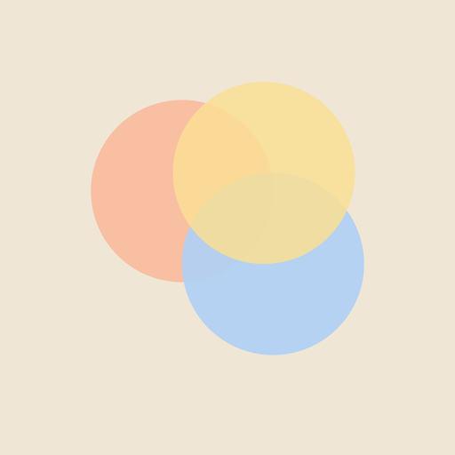

  

<h1 align="center">Busy phone</h1>

<em>Un busy board pour le téléphone, tout en douceur.</em>

 

> Pour les trajets en voiture ou en train, j'ai voulu autre chose que les dessins animés pour occuper ma fille, sans un jouet de plus à porter. Le téléphone, qu'on a déjà sur soi, devient un objet à toucher et à écouter : un **busy phone** plutôt qu'une application.

## Dedans

| | Écran | On y fait quoi |
|:-:|---|---|
| 🎨 | **Couleurs** | Un tap fait une tache douce, un glissement trace un ruban qui s'efface. |
| 🎛️ | **Commandes** | Boutons, interrupteur, jauge, bouton de volume. |
| 🎶 | **Xylophone** | 8 lames, mêmes couleurs et mêmes notes que le reste. |

## Parti pris

**Calme avant tout** : tons pastel, mouvements lents, sons espacés.
Pas de score, pas de texte, pas de publicité, pas de compte, rien d'envoyé nulle part.

## Espace parent

Un appui long sur le rond en haut à gauche ouvre :

- un **chrono** (10, 15, 20 min ou +5 min) : à la fin, l'écran s'estompe doucement jusqu'à un écran de repos ;
- le **volume** ;
- le **fond** jour ou soir (ou automatique).

## Installer

1. Ouvrir le lien dans Chrome sur Android.
2. Menu **⋮** → **Installer l'application**.
3. L'icône s'ouvre en plein écran et fonctionne hors ligne.

 

Un seul fichier HTML, sans dépendance.

